<p align="center">
  
</p>

<h1 align="center">Radar Territorial</h1>

<p align="center">
  <b>Painel de inteligência territorial que antecipa problemas de clima, recursos e serviços na Subprefeitura do Butantã (SP), mostrando a evidência de cada alerta e deixando a decisão final com uma pessoa.</b>
</p>

<p align="center">
  Global Solution 2026.2 · Cross-Platform Application Development · Desafio <i>Territory Predictive Insights</i> (CitizenTech)
</p>

---

## 1. Problema e público

**Problema.** Muitos problemas de um bairro dão sinais antes de virar crise: o reservatório cai devagar por semanas, o consumo de água de um distrito sobe de repente (vazamento), a previsão indica vários dias de calor extremo, a procura nas UBS cresce semana após semana, os chamados de bueiro entupido aumentam antes de um alagamento. Esses dados existem, mas ficam espalhados e quase nunca são olhados juntos e a tempo.

**Território escolhido.** Subprefeitura do Butantã, zona oeste de São Paulo, com 5 distritos (Butantã, Morumbi, Raposo Tavares, Rio Pequeno e Vila Sônia) e cerca de 428 mil habitantes.

**Para quem.**
- **Gestores públicos** (subprefeitura, Defesa Civil, saúde, zeladoria): acompanham os indicadores, analisam os alertas e registram a decisão tomada.
- **Cidadãos**: registram ocorrências de forma anônima (vazamento, alagamento, lixo...), que entram como evidência nos alertas.

**Impacto social esperado.** Agir antes: avisar idosos antes de uma onda de calor, mandar a equipe da companhia de saneamento antes de perder milhões de litros num vazamento, reforçar a UBS antes da fila explodir. O app mostra no painel inicial quantos **moradores** estão em áreas com ação preventiva confirmada e quantos **litros de água por dia** podem deixar de ser desperdiçados.

> ⚠️ O app **nunca toma decisão sozinho**. Todo alerta mostra evidência, nível de confiança e limitações, e só uma pessoa pode confirmar ou descartar.

## 2. Integrantes


| Gabriel Ramos Moreira | RM564074 |
| Vinicius Mello Siqueira | RM565257 |


## 3. Demonstração visual

Todas as telas do app (prints tirados do app rodando, em tamanho de celular). Imagens em [`assets/screenshots/`](assets/screenshots).

| Consentimento (LGPD) | Visão geral | Impacto social e dashboards |
|:---:|:---:|:---:|
| 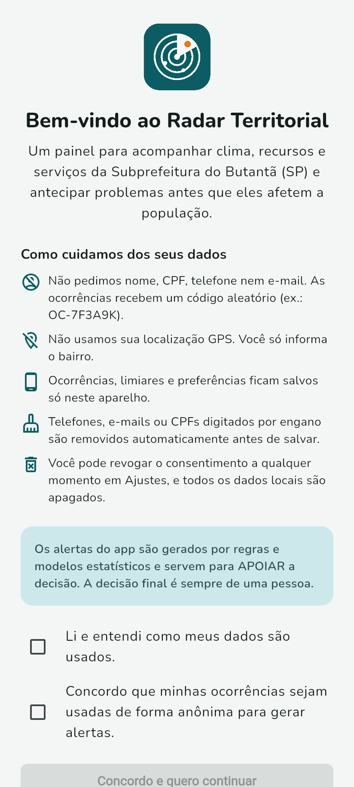 | 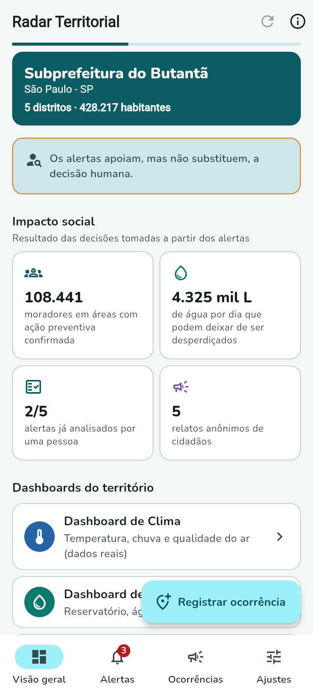 | 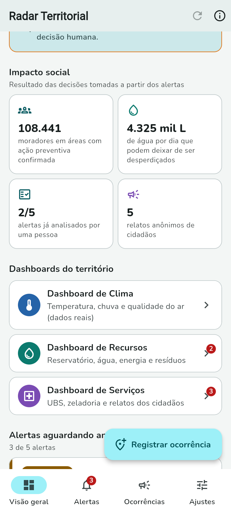 |
| Primeiro acesso: explica o uso dos dados e pede consentimento explícito | Território, aviso de decisão humana e resumo | Indicadores de benefício social e atalhos para os 3 dashboards |

| Dashboard de Clima | Dashboard de Recursos | Dashboard de Serviços |
|:---:|:---:|:---:|
| 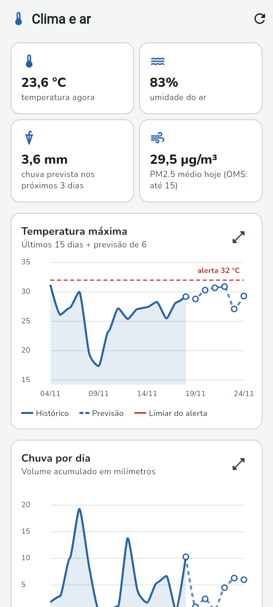 | 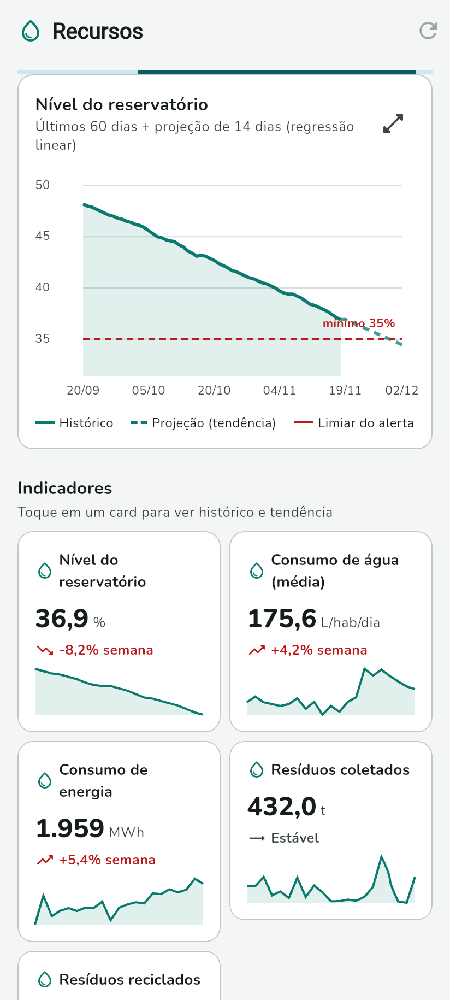 | 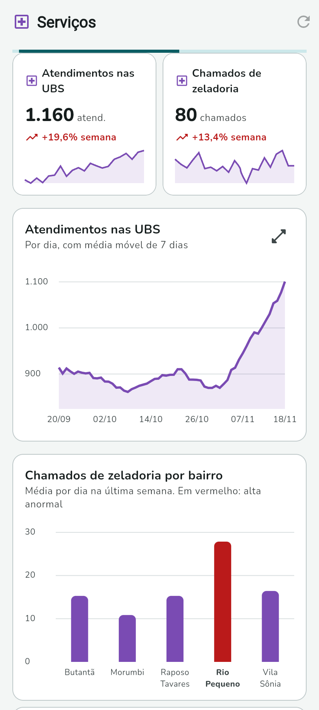 |
| Dados reais do Open-Meteo: temperatura, chuva, previsão e PM2.5 | Reservatório com projeção, água por bairro, energia e resíduos | UBS, chamados de zeladoria por bairro e relatos |

| Detalhe do indicador | Lista de alertas | Detalhe do alerta |
|:---:|:---:|:---:|
| 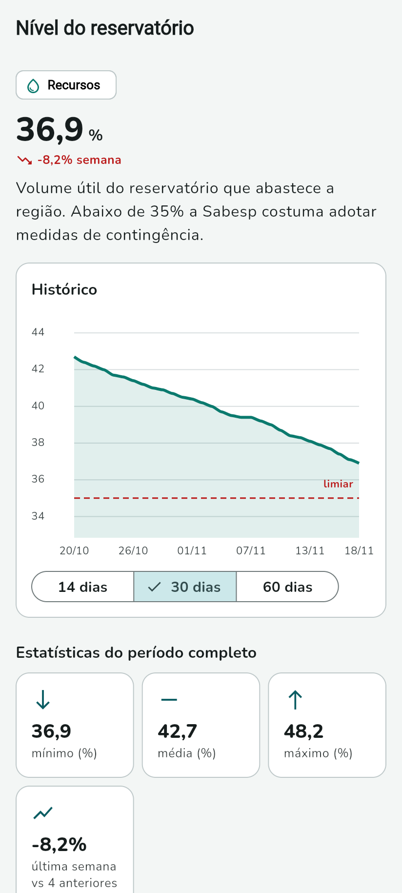 | 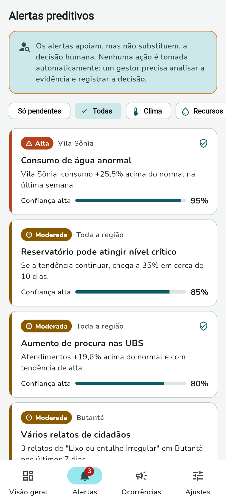 | 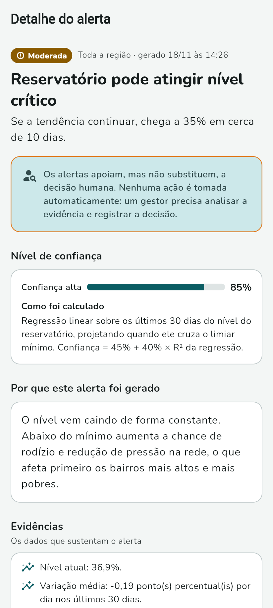 |
| Histórico com período ajustável, estatísticas e alertas ligados | Filtros por categoria e situação, com aviso de decisão humana | Confiança, justificativa e evidências |

| Limitações e decisão | Registrar ocorrência | Validação do formulário |
|:---:|:---:|:---:|
| 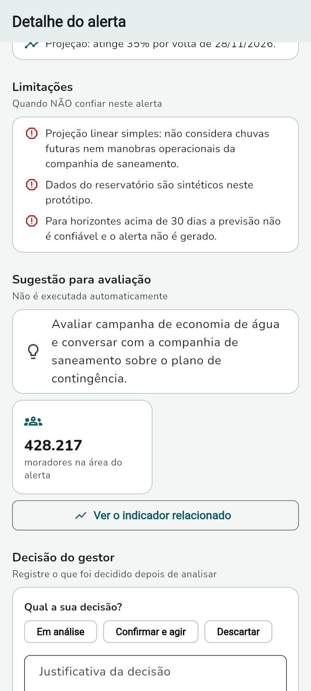 | 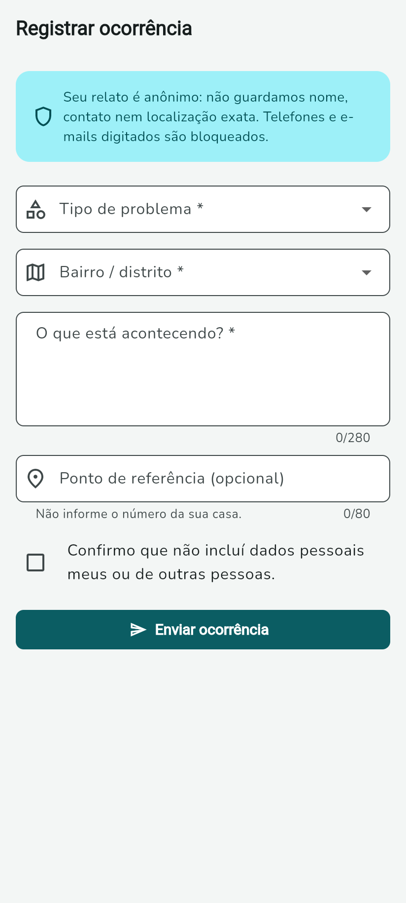 | 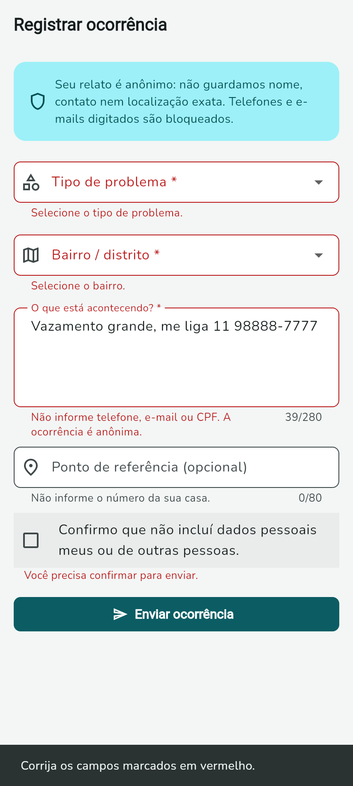 |
| Quando não confiar no alerta e registro da decisão humana | Formulário anônimo do cidadão | Mensagens de erro claras |

| Ocorrências | Ajustes e acessibilidade | Limiares dos alertas |
|:---:|:---:|:---:|
| 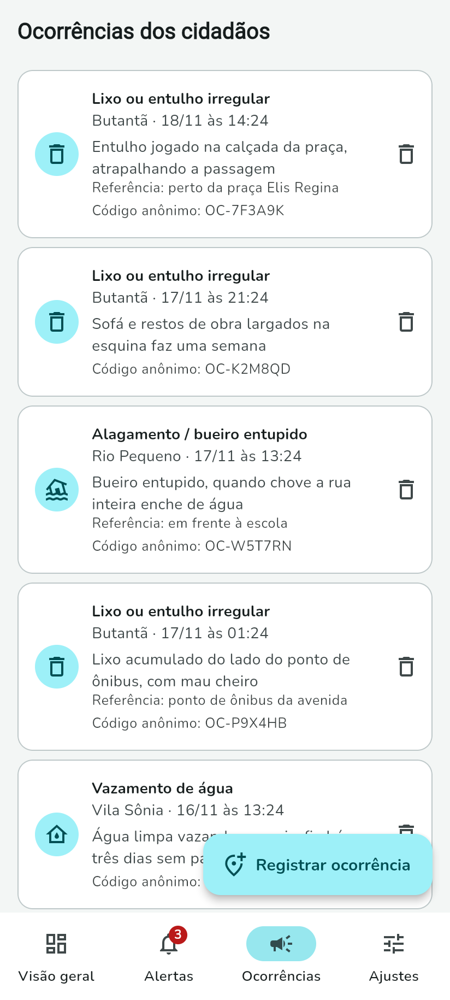 | 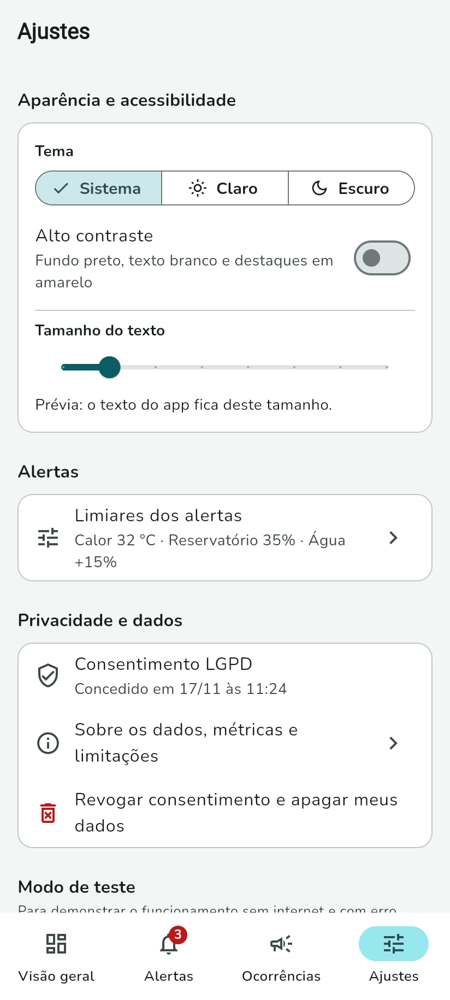 | 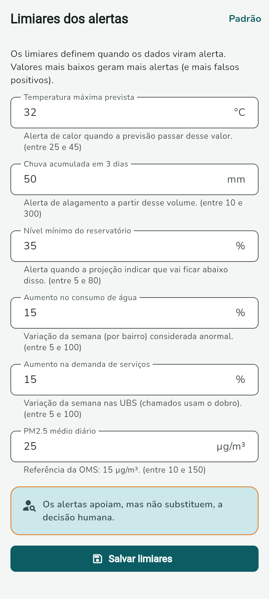 |
| Relatos salvos no aparelho (código anônimo) | Tema, alto contraste, fonte, privacidade e modo de teste | Formulário com validação de faixa |

| Sobre os dados | Modo escuro | Alto contraste + fonte grande |
|:---:|:---:|:---:|
| 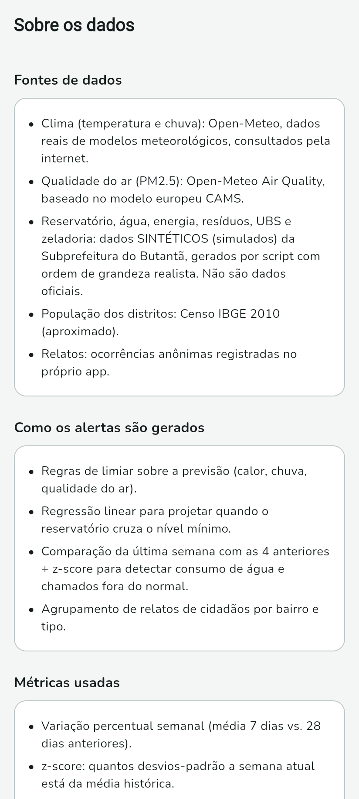 | 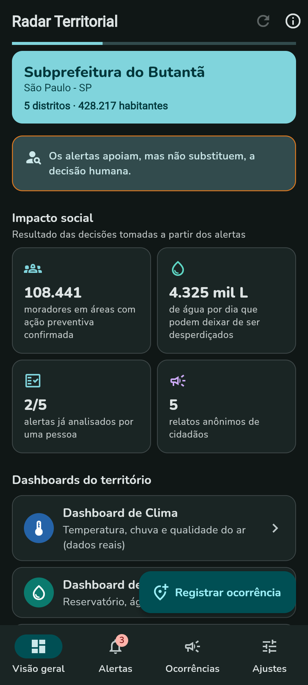 | 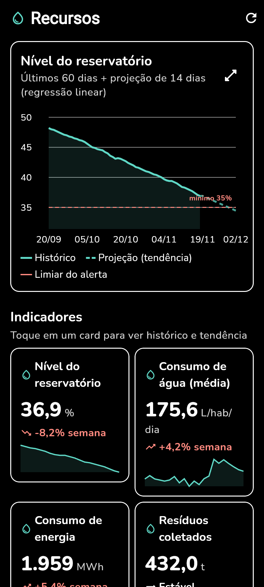 |
| Fontes, métricas, vieses e quando as previsões não são confiáveis | Tema escuro | Acessibilidade |

| Sem internet (cache) | Erro de servidor | Lista vazia |
|:---:|:---:|:---:|
| 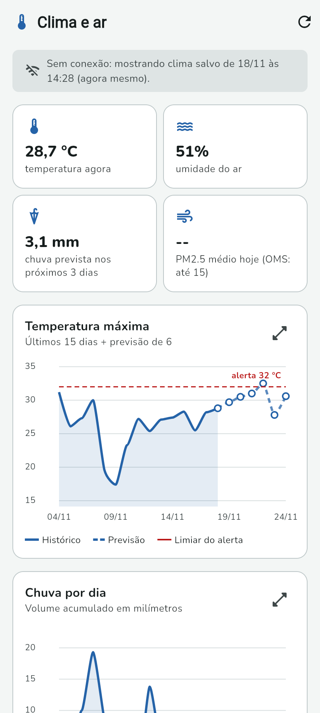 | 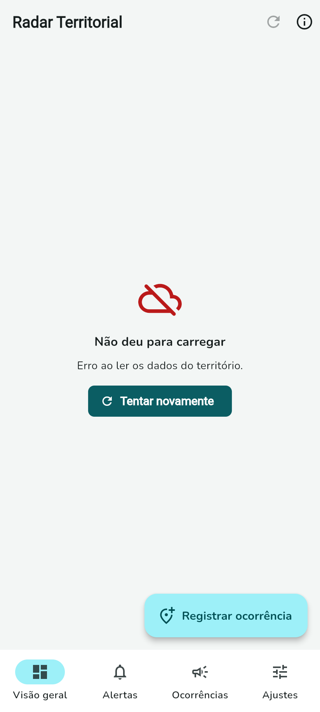 | 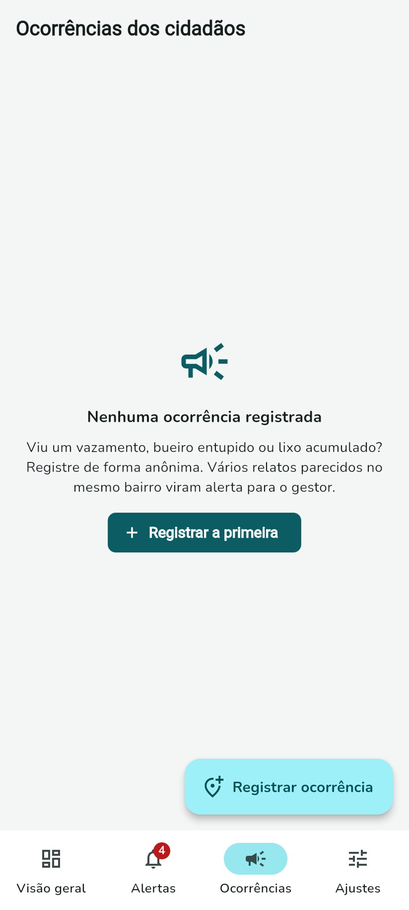 |
| Clima vindo do cache, com aviso | Estado de erro com "Tentar novamente" | Estado de lista vazia |

## 4. Funcionalidades

**Navegação e fluxo**
- [x] 13 telas com **rotas nomeadas** (`lib/core/routes/app_routes.dart`) e passagem de parâmetro (id do indicador e do alerta, via `arguments` ou no próprio caminho, ex.: `/alerta/reservatorio`)
- [x] Fluxo visão geral → dashboard → detalhe do indicador → detalhe do alerta (e o caminho de volta pelo alerta → indicador)
- [x] Barra de navegação inferior (Visão geral, Alertas, Ocorrências, Ajustes)

**Dashboards territoriais**
- [x] **Clima e ar** (API real): temperatura máxima com histórico de 14 dias + previsão de 7, chuva diária, cards de previsão, PM2.5
- [x] **Recursos**: nível do reservatório com projeção por regressão, consumo de água por bairro, energia, resíduos e reciclagem
- [x] **Serviços**: atendimentos nas UBS com média móvel, chamados de zeladoria por bairro, relatos dos cidadãos por categoria
- [x] Cards com valor atual, tendência semanal (seta + %) e mini gráfico; gráficos com linha de limiar

**Alertas preditivos e transparência**
- [x] 8 tipos de alerta gerados a partir dos dados (calor, alagamento, qualidade do ar, reservatório, consumo de água anormal, demanda nas UBS, chamados de zeladoria, relatos repetidos)
- [x] Cada alerta mostra **justificativa**, **evidências** (números), **nível de confiança** (% e como foi calculado), **limitações** e sugestão
- [x] Aviso fixo: _"Os alertas apoiam, mas não substituem, a decisão humana"_
- [x] Registro da **decisão humana** (em análise / confirmar / descartar) com justificativa obrigatória
- [x] Limiares configuráveis pelo gestor (os alertas são recalculados na hora)

**Estado, dados e persistência**
- [x] Estado global com Provider (4 providers compartilhados entre várias telas) e estado local com `setState` (filtros, formulários, período do gráfico)
- [x] Estados de carregamento, erro (com "Tentar novamente") e lista vazia em todas as telas de dados
- [x] Consumo da API real do Open-Meteo (clima e qualidade do ar) + serviço simulado com atraso e falha
- [x] Persistência local: ocorrências, decisões, limiares, preferências, consentimento e cache do clima
- [x] Funciona sem internet: o clima vem do cache (com aviso e confiança reduzida) e o resto é local

**Formulários**
- [x] Registro de ocorrência pelo cidadão: campos obrigatórios, tamanho mínimo/máximo, bloqueio de telefone/e-mail/CPF, confirmação de anonimato
- [x] Configuração de limiares: validação de número e faixa
- [x] Decisão do gestor: opção obrigatória e justificativa mínima

**Identidade visual, acessibilidade e privacidade**
- [x] Tema próprio (cores, fonte Nunito, espaçamentos) centralizado em `lib/core/theme`
- [x] Componentes reutilizáveis em `lib/widgets` (cards, gráficos, estados, chips)
- [x] Modo claro, escuro e **alto contraste**; tamanho de fonte ajustável (respeita a fonte do sistema)
- [x] Rótulos para leitor de tela (Semantics/tooltip) em gráficos, cards e botões de ícone
- [x] Layout responsivo (grade que muda o número de colunas, largura máxima em tablet)
- [x] Tela de consentimento LGPD, ocorrências anônimas e opção de revogar e apagar tudo
- [x] Indicadores de benefício social na tela inicial

**Diferenciais (bônus)**
- [x] Dados reais (Open-Meteo, clima e qualidade do ar)
- [x] Modo escuro e tema de alto contraste
- [x] Testes automatizados (unidade e widget) cobrindo alertas e validações
- [x] Animações com propósito (barra de confiança animada)
- [x] APK de release (ver Releases do repositório)

## 5. Dados e alertas

### Fontes

| Dado | Fonte | Tipo |
|---|---|---|
| Temperatura, chuva, previsão 7 dias | [Open-Meteo Forecast API](https://open-meteo.com/) | **Público / real** |
| PM2.5 (qualidade do ar) | [Open-Meteo Air Quality API](https://open-meteo.com/en/docs/air-quality-api) (modelo CAMS) | **Público / real** |
| Nível do reservatório, consumo de água por bairro, energia, resíduos, UBS, chamados 156 | `assets/data/territorio.json`, gerado por `tools/gerar_dados_sinteticos.py` (seed fixa) | **Sintético** |
| População dos distritos | Censo IBGE 2010 (aproximado) | Público |
| Ocorrências | Registradas pelos usuários no app | Autorizado (com consentimento) |

Os dados sintéticos guardam só a sequência de valores dos últimos 60 dias. O app converte para datas reais ao carregar (o último valor é "hoje"), então o painel nunca fica com dados "velhos". O serviço que lê esses dados (`TerritorioService`) simula uma API: tem atraso de rede e pode falhar (modo de teste).

### Como os alertas são gerados

Toda a lógica fica em `lib/services/motor_alertas.dart` e é coberta por testes.

| Alerta | Regra / modelo | Confiança |
|---|---|---|
| Calor / onda de calor | Algum dia da previsão ≥ limiar (padrão 32 °C). 3+ dias seguidos sobem a severidade | 85% (1 dia) → 50% (6-7 dias de antecedência) |
| Alagamento | Soma da chuva prevista em 3 dias ≥ limiar (50 mm) | Probabilidade média de chuva × 0,85, máx. 80% |
| Qualidade do ar | PM2.5 médio previsto ≥ limiar (25 µg/m³) | Pela antecedência, −10% (modelo regional) |
| Reservatório | Regressão linear dos últimos 30 dias e projeção de quando cruza o mínimo (35%) | 45% + 40% × R² |
| Consumo de água anormal | Média dos últimos 7 dias vs. 4 semanas anteriores ≥ +15% **e** z-score ≥ 2 | 45% + 8% × z, −15% se a semana foi quente |
| Demanda nas UBS | Variação semanal ≥ +15% + regressão das últimas 3 semanas | 40% + 45% × R² |
| Chamados de zeladoria | Variação ≥ 2× o limiar (+30%) **e** z-score ≥ 2 | 40% + 7% × z, + relatos de cidadãos |
| Relatos de cidadãos | 3+ relatos da mesma categoria no mesmo bairro em 7 dias | 45% + 5% por relato |

Níveis: **alta** ≥ 75%, **média** ≥ 55%, **baixa** abaixo disso. Toda confiança fica entre 20% e 95%, porque nenhum alerta é 100% certo.

### Métricas usadas
- Variação percentual semanal (média 7 dias vs. 28 dias anteriores)
- z-score (distância da semana atual para a média histórica, em desvios-padrão)
- Regressão linear por mínimos quadrados e R² (qualidade do ajuste)
- Média móvel de 7 dias (suavização do gráfico das UBS)

### Limitações e quando as previsões não são confiáveis
- Previsão do tempo para mais de 5 dias e pancadas de chuva localizadas
- Clima em cache com mais de 6 horas: a confiança cai 15% e o alerta avisa
- Projeção do reservatório acima de 30 dias: o app **não** gera o alerta
- Regressão linear não prevê mudanças de tendência (chuva forte, fim de surto)
- Eventos atípicos (feriados, obras, grandes eventos) aparecem como "anomalia"
- Os dados de recursos e serviços são sintéticos: servem para demonstrar a lógica, não para decisões reais

### Possíveis vieses
- **Viés de registro**: bairros com menos acesso à internet ou ao 156 registram menos chamados e relatos, então problemas reais podem ficar escondidos.
- **Resolução espacial**: o modelo de clima não capta ilhas de calor em comunidades com pouca vegetação.
- **Dados sintéticos** refletem as escolhas de quem os gerou.

Tudo isso aparece também dentro do app, na tela **Sobre os dados** e na seção "Limitações" de cada alerta.

## 6. Privacidade e inclusão

**Privacidade (LGPD)**
- Tela de **consentimento explícito** no primeiro acesso (duas confirmações). Sem consentimento o app não abre.
- Ocorrências **anônimas**: sem nome, CPF, telefone, e-mail ou GPS. Cada uma recebe um código aleatório (ex.: `OC-7F3A9K`).
- O formulário **bloqueia** telefone, e-mail, CPF e número de casa, e um anonimizador mascara o que passar antes de salvar (`Anonimizador` em `lib/core/utils/validadores.dart`).
- Dados agregados por bairro: o app nunca identifica o imóvel (inclusive no alerta de vazamento).
- Atendimentos nas UBS só como total, sem doença, para não expor dados de saúde.
- Tudo fica salvo só no aparelho, e o usuário pode **revogar o consentimento e apagar tudo** em Ajustes.

**Acessibilidade e inclusão**
- Tema de **alto contraste** (preto, branco e amarelo) e modo escuro
- **Tamanho de texto** ajustável de 90% a 160%, multiplicado pela fonte do sistema
- Cores de severidade testadas com contraste ≥ 4.5:1 com texto branco, e a severidade também aparece por **ícone e texto** (não só cor)
- `Semantics` com descrição em gráficos, cards, indicadores e alertas, além de `tooltip` em todos os botões de ícone, para TalkBack/VoiceOver
- Botões com no mínimo 48 dp de altura
- Linguagem simples nas justificativas

## 7. Tecnologias e decisões técnicas

| Tecnologia | Por que |
|---|---|
| **Flutter 3 / Dart 3** | Exigência da disciplina; um código para Android, iOS e web |
| **provider** | Gerenciamento de estado visto em aula, simples e suficiente. `ChangeNotifier` separa bem o estado global (dados, alertas, configurações) do local (`setState` nos formulários e filtros) |
| **fl_chart** | Gráficos de linha e barras customizáveis (linha de limiar, previsão tracejada, tooltip) sem depender de serviço externo |
| **http** | Chamadas REST para o Open-Meteo; dá para trocar o client nos testes (`MockClient`) |
| **shared_preferences** | Persistência local simples em chave/valor (JSON). O volume de dados é pequeno, então banco SQL seria exagero |
| **Open-Meteo** | API pública e gratuita, **sem chave**, com previsão e qualidade do ar. Nenhuma credencial no código |
| **Fonte Nunito** (empacotada) | Identidade visual e legibilidade; funciona offline (não usa google_fonts em tempo real) |

**Arquitetura** (camadas simples, separadas por pasta):

```
lib/
├── main.dart                # inicia o storage e registra os providers
├── app.dart                 # MaterialApp, temas, rotas e escala de fonte
├── core/
│   ├── config/              # URLs da API e parâmetros (dart-define)
│   ├── routes/              # rotas nomeadas e passagem de parâmetros
│   ├── theme/               # cores, espaçamentos e temas (claro/escuro/alto contraste)
│   └── utils/               # estatística, formatação, validação e anonimização
├── models/                  # Indicador, Alerta, Ocorrencia, Limiares, DadosClima...
├── services/                # API do clima, serviço simulado, storage, indicadores e MOTOR DE ALERTAS
├── providers/               # estado global: Config, Territorio, Ocorrencias, Alertas
├── screens/                 # telas, uma pasta por funcionalidade
└── widgets/                 # componentes reutilizáveis (cards, gráficos, estados...)
test/                        # testes de unidade e de widget
tools/                       # script que gera os dados sintéticos
```

Fluxo dos dados: `services` busca → `TerritorioProvider` guarda e monta os indicadores → `AlertasProvider` escuta os outros providers e recalcula os alertas sempre que os dados, os limiares ou as ocorrências mudam → as telas só leem com `context.watch`.

## 8. Como executar

**Pré-requisitos:** Flutter 3.27+ (testado no canal stable), Android Studio ou VS Code, emulador Android ou celular com depuração USB.

```bash
# 1. clonar
git clone https://github.com/gabrielramos1403/radar_territorial.git
cd radar-territorial

# 2. instalar as dependências
flutter pub get

# 3. rodar (com emulador aberto ou celular conectado)
flutter run

# 4. rodar os testes
flutter test
```

**Variáveis de ambiente:** o app **não precisa de chave de API** (Open-Meteo é aberto). Se quiser apontar para outro servidor, dá para passar na hora de rodar:

```bash
flutter run --dart-define=URL_CLIMA=https://api.open-meteo.com/v1/forecast \
            --dart-define=URL_QUALIDADE_AR=https://air-quality-api.open-meteo.com/v1/air-quality
```

**Gerar o APK:** `flutter build apk --release` (o arquivo fica em `build/app/outputs/flutter-apk/app-release.apk`). O APK pronto está na aba **Releases** do repositório.

**Regerar os dados sintéticos (opcional):** `python tools/gerar_dados_sinteticos.py`

**Dica para testar:** em **Ajustes → Modo de teste** dá para simular falta de internet (o clima vem do cache) e falha do servidor (mostra o estado de erro).

## 9. Vídeo

▶️ **[Assistir à demonstração no YouTube](https://youtu.be/LINK_DO_VIDEO)** (até 3 minutos)


